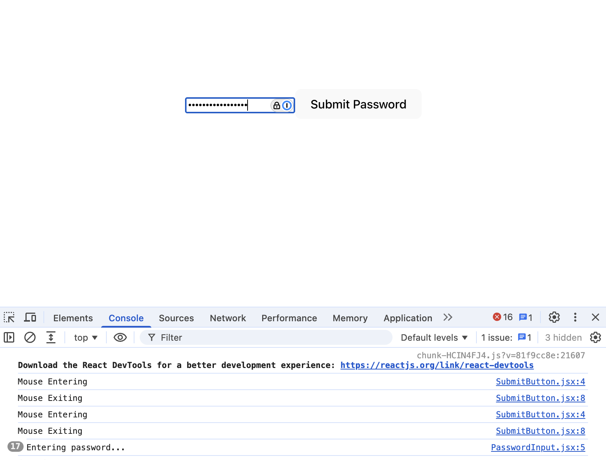

# Password Input

A small React app that tracks typing in a password field and mouse hover on the submit button, so an engineer can later attach anti-bot logic to these events.

## How to run

1. Clone the repo and `cd` into it
2. `npm install`
3. `npm run dev` and open the local URL printed in the terminal
4. Open the browser console (Cmd+Option+J), type in the box, and hover on and off the button
5. `npm test` to run the tests

## Screenshots



## Component tree

```
App
├── PasswordInput
└── SubmitButton
```

## Components

- **App**: Root component. Renders PasswordInput and SubmitButton.
- **PasswordInput**: Renders a password `<input>`. `handleChange` runs on every change event and logs "Entering password...". Child of App.
- **SubmitButton**: Renders a "Submit Password" `<button>`. `handleEnter` logs "Mouse Entering" on mouse enter, and `handleLeave` logs "Mouse Exiting" on mouse leave. Child of App.